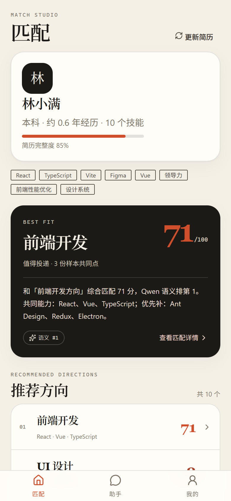
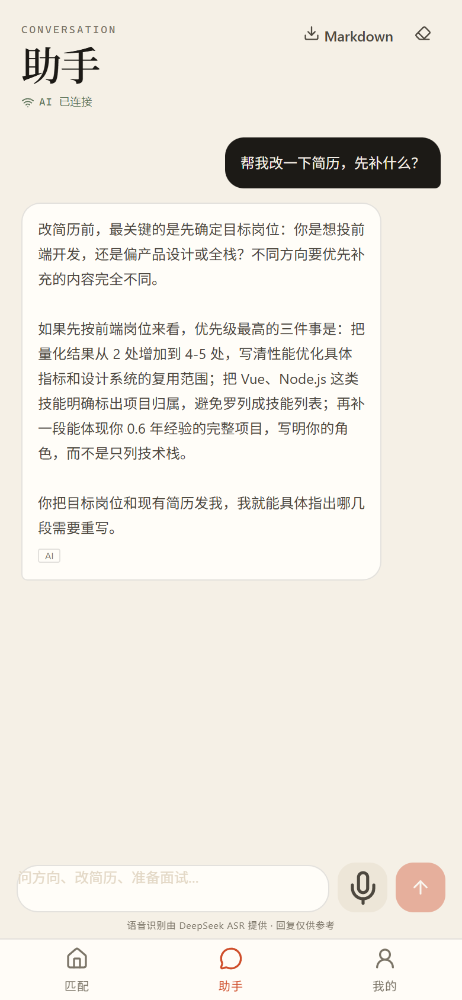

# Offer 捕手 · Offer Catcher

**把简历变成可解释的岗位匹配。**  
一个本地优先的 Android 求职助手：导入简历 → 匹配方向 → 和助手一起改简历 → 导出 Markdown。

> 当前版本 **v2.0.0** · EE5415 Individual Project · City University of Hong Kong

## 三个模块

### 1. 匹配

- 导入 PDF / DOCX / TXT，或直接粘贴简历文本；解析在本机完成。
- 从你提供的 21 份方向简历中聚合出 10 个岗位画像（前端、后端、产品、UI、数据、测试、运维、算法、市场、HR）。
- 本地五维匹配 + 阿里云 Qwen qwen3.7-text-embedding 语义排序。
- 展示综合匹配、命中/待补技能、共同点、方向和改写建议。
- 不再使用手写 mock 岗位；岗位画像来自脱敏后的简历聚合。

### 2. 助手

- 带入你的简历和方向匹配上下文，回答“适合什么方向 / 怎么改简历 / 面试怎么准备”。
- **语音输入**：浏览器录音 → WAV → 后端 DeepSeek ASR（/v1/tools/asr 转录），自动填入输入框。
- **导出 Markdown 简历**：根据本机简历生成推荐的 Markdown 版本，保存到 Documents 或直接下载。
- AI 不可用时自动回退到本地规则回答。

### 3. 我的

- AI 开关、代理地址、连接测试。
- 导出本机数据（JSON，不含 API key）。
- 清空数据 / 恢复出厂。
- 隐私说明、岗位画像数据来源、版本信息。

## 为什么是 Markdown，不是 PDF

v2 的简历导出是 **Markdown**，这是有意的 P0 取舍：

- PDF 通常需要把 HTML 渲染成 PDF；针对不同候选人的字体、分页、项目长度和模板做调优，属于大量 dirty work。
- 对当前版本，Markdown 已经能完整保留内容、可复制、可继续编辑，也能被大多数 Markdown/Word 工具导入。
- HTML → PDF 的模板化导出列为下一步，而不是 P0；报告中有同样的说明。

## 数据与匹配逻辑

- **原始简历不进入仓库**：resumes/ 是本地数据，已 gitignore；仓库只保留脱敏聚合后的画像和 1024 维向量。
- 文本提取：PDF 用 pypdf；JPG 用 Tesseract 中文 OCR。
- 方向画像：DeepSeek 对每个方向的简历文本归纳共同技能、经历主题、关键点、要求和关键词。
- 语义排序：10 个画像用 Qwen embedding 预计算；候选人简历通过代理 /api/ai/embed 做一次 embedding，和画像算余弦相似度；最终分 = 60% 本地 + 40% 语义。
- 岗位画像是“这个方向的候选人通常具备什么”，**不是实时招聘岗位**；真实 JD 仍建议通过粘贴方式分析。

详见 [resume-corpus-analysis.md](docs/resume-corpus-analysis.md)。

## 技术栈

| 层 | 选择 |
| --- | --- |
| 客户端 | React 18.3 + Vite 8 + React Router 7 + Zustand 5 |
| UI | **Ant Design Mobile 5.43** + 自定义奶油/墨色主题 |
| Android | Capacitor 8 · SDK 36 · minSdk 24 · JDK 21 |
| AI 代理 | Node.js 22 + Express 4 |
| 对话 | DeepSeek deepseek-flash / deepseek-v4-pro |
| Embedding | 阿里云 DashScope qwen3.7-text-embedding（1024 维） |
| 语音 | DeepSeek ASR /v1/tools/asr |
| 测试 | Vitest（客户端）+ Node test runner（代理） |

## 运行

~~~bash
# 1) 代理
cp .env.example .env   # 填入 DEEPSEEK_API_KEY / EMBEDDING_API_KEY
cd backend && npm install && npm run dev

# 2) 客户端
cd frontend && npm install && npm run dev
# http://localhost:5173
~~~

Android 模拟器/真机：

~~~bash
adb reverse tcp:3001 tcp:3001
adb install -r release/OfferCatcher-v2.0.0.apk
~~~

模拟器上 AI 代理通过 adb reverse 访问；如果使用 Wi-Fi 真机，在「我的 → 代理地址」里改成电脑局域网 IP。

## 测试与构建

~~~bash
npm test                  # 21 client + 10 proxy tests
cd frontend && npm run build
cd frontend && npx cap sync android
cd frontend/android && gradlew.bat assembleRelease
~~~

- Web E2E：真实 PDF 导入、匹配、助手对话、Markdown 下载、数据导出，0 console error。
- 语音：用 fake audio + Chrome 真实走通 录音 → DeepSeek ASR → 输入框。
- Android：v2.0.0（versionCode 3）已构建为 signed release APK。

## 交付物

| 交付物 | 链接 |
| --- | --- |
| 签名 APK | [release/OfferCatcher-v2.0.0.apk](release/OfferCatcher-v2.0.0.apk) |
| Final Report | [PDF](docs/OfferCatcher_Final_Report.pdf) · [Markdown](docs/report.md) |
| Proposal | [PDF](docs/OfferCatcher_Proposal.pdf) · [Markdown](docs/proposal.md) |
| Presentation | [PDF](docs/slides/OfferCatcher_EE5415_Slides.pdf) · [PPTX](docs/slides/OfferCatcher_EE5415_Slides.pptx) |
| 语料分析 | [resume-corpus-analysis.md](docs/resume-corpus-analysis.md) |
| Testing | [docs/testing.md](docs/testing.md) |
| Demo script | [docs/demo-script.md](docs/demo-script.md) |

## 限制

- 21 份简历、每个方向 2–3 份，样本量小；画像是方向参考，不是实时岗位。
- OCR 对 JPG 截图会有噪声，PDF 文本质量更好。
- AI 回答与画像归纳可能出错，UI 明确标注“仅供参考”。
- PDF 简历导出、真实岗位 API、通知/相机/分享不在 v2 的 P0 范围。

## License

MIT
