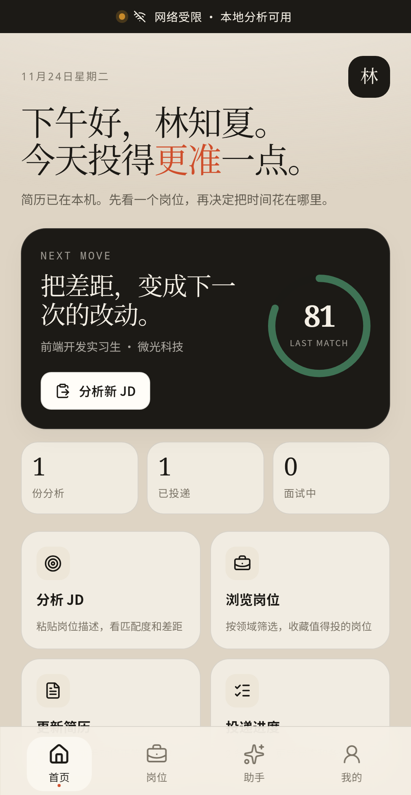
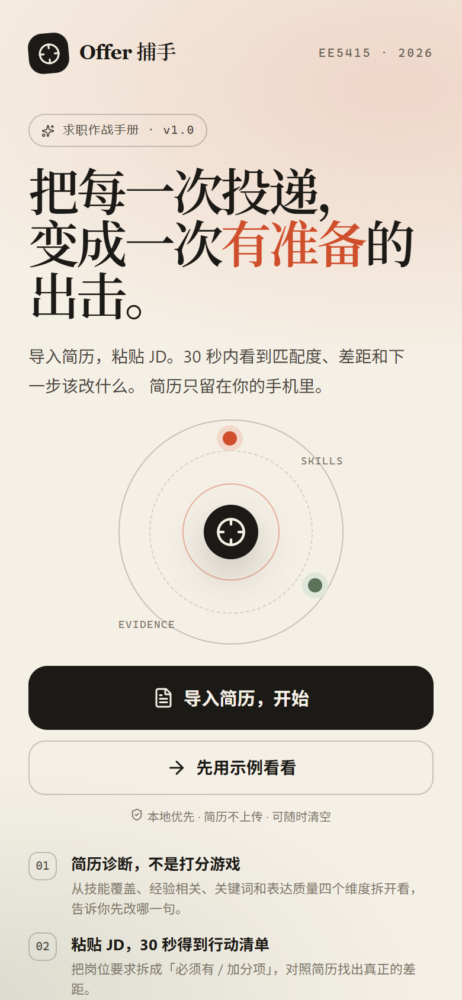
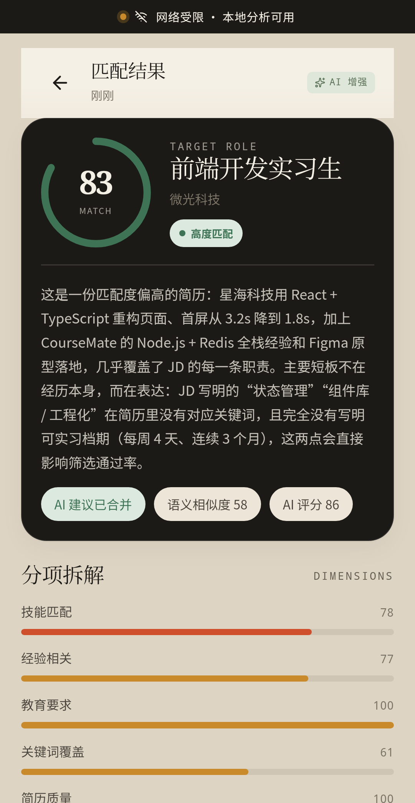
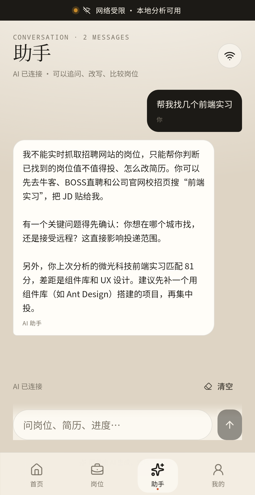
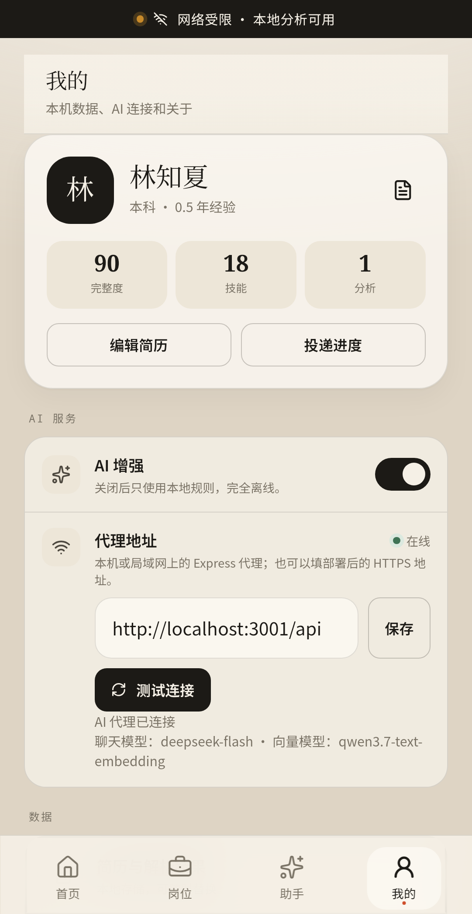

# Offer 捕手 · Offer Catcher

> **Paste a JD. Get a match report in seconds. Keep every application moving.**
> A mobile-first, offline-first job-search copilot for students — built with React + Capacitor 8 for Android.

**中文一句话**：把简历留在手机里，把 JD 拆成可执行的改写清单；没有网络也能做匹配，连上自己的 AI 代理后自动补充更具体的建议。

## The problem

Students apply to many roles with the same resume and get little feedback. Job boards help them find postings, but not decide **whether a posting is worth tailoring a resume for**, or **what to change first**. Generic resume scanners return a score without a plan; desktop-first tools are awkward on a phone; most upload the resume to an unknown server.

## The product

Offer Catcher turns a resume and a job description into a concrete match report and a lightweight application pipeline:

1. **Import a resume** — PDF, DOCX, TXT or Markdown. Parsing and matching happen on the device.
2. **Paste a JD or pick a sample role** — skills, years and education requirements are extracted locally.
3. **Get a match report** — score, five dimensions, matched/missing skills, strengths, gaps and 3–6 specific rewrite actions.
4. **Improve the application** — save the role, add it to the pipeline, update status and notes.
5. **Ask the assistant** — AI-backed when the optional proxy is reachable; local intent handling otherwise.

The core loop works **without a network or an account**. The AI is an optional enhancement, not a dependency.

## Screens

| | |
| --- | --- |
| **Welcome / onboarding**  | **Match report**  |
| **AI assistant**  | **Settings & AI connection**  |

More screens: [resume editor](docs/assets/screens/03-resume.png), [JD analysis](docs/assets/screens/04-analyze.png), [job board](docs/assets/screens/05-jobs.png), [job detail](docs/assets/screens/06-job-detail.png), [tracker](docs/assets/screens/07-tracker.png).

## Why it is different

| Common tools | Offer Catcher |
| --- | --- |
| Upload a resume to a server and get a score | Resume stays on the phone; matching runs locally |
| Desktop dashboards squeezed into a WebView | Mobile-first UI designed around a phone in one hand |
| Generic “improve your resume” advice | Action list tied to the exact JD, with matched/missing skills |
| One-off scan | A lightweight pipeline: saved → applied → interview → offer / rejected |
| AI required for every action | Deterministic local engine first; AI is optional and proxied |

The visual language is a **career field journal** rather than a generic blue dashboard: warm paper, ink, vermilion accents, serif display type and a match ring that recurs across the product.

## Android platform integration

Implemented with Capacitor plugins and the Android WebView:

- **Native preferences storage** — profile, analyses, tracker and settings survive app restarts.
- **Network status** — offline-aware UI; local analysis remains available.
- **Status bar + edge-to-edge layout** — cream system bars with dark icons, safe-area spacing.
- **Splash screen and adaptive icon** — generated from a custom brand mark.
- **Hardware back button** — closes sheets, returns to the previous screen, exits from home.
- **Native document picker** — importing PDF/DOCX through Android's file chooser.
- **Filesystem export** — JSON backup written to the device's Documents folder.
- **Haptics** — subtle feedback on primary actions.

Camera capture, notifications and the native share sheet are **deliberately out of scope** for this iteration (see Scope and non-goals).

## Architecture

~~~text
┌──────────────────────────────────────────────┐
│ Capacitor Android shell                      │
│  React 19 + Vite 8 mobile UI (HashRouter)    │
│                                              │
│  screens → Zustand + Preferences             │
│           → local parser + match engine      │
│           → API client ───────────────┐      │
│  native: status bar, splash, back,    │      │
│          network, filesystem, haptics │      │
└───────────────────────────────────────┼──────┘
                                        │ HTTP(S) / LAN
                              ┌─────────▼──────────┐
                              │ Express AI proxy   │
                              │  DeepSeek chat     │
                              │  Qwen embeddings   │
                              │  excellent-resume  │
                              │  RAG (JSON cache)  │
                              └────────────────────┘
~~~

- **Local engine** — resume/JD parsing, skill coverage, experience/education/keyword/quality scoring, rewrite suggestions.
- **Optional AI proxy** — DeepSeek chat (deepseek-flash, fallback deepseek-v4-pro) and Qwen text embeddings (qwen3.7-text-embedding, 1024-d) with a compact excellent-resume RAG index. Keys live only in the proxy's .env.
- **No MySQL, COS or LanceDB** in the final runtime. The earlier prototype's server dependencies were removed to make the physical-device demo resilient.

## Tech stack

| Layer | Technology |
| --- | --- |
| Mobile client | React 19, Vite 8, React Router 7, Zustand 5, Lucide |
| Native shell | Capacitor 8 (Android SDK 36, minSdk 24), JDK 21 |
| Local parsing | pdfjs-dist, JSZip (browser DOCX XML extraction) |
| AI proxy | Node.js 22, Express 4, DeepSeek + Alibaba Cloud MaaS embeddings |
| Storage | @capacitor/preferences on Android, localStorage on web |
| Tests | Vitest (client), Node test runner (proxy) |
| Build | npm, Gradle 8.14.3, AGP 8.13.0 |

## Run it

### 1. AI proxy (optional but recommended for the full demo)

~~~bash
cp .env.example .env
# Fill DEEPSEEK_API_KEY and EMBEDDING_API_KEY in .env
npm --prefix backend install
npm --prefix backend run dev
# → http://localhost:3001/api/health
~~~

The proxy exposes /api/health, /api/ai/analyze, /api/ai/chat and /api/ai/embed. It validates AI JSON, repairs occasional malformed output, limits input size and rate, and falls back to the local result on failure.

### 2. Web development

~~~bash
npm --prefix frontend install
npm run dev
# → http://localhost:5173
~~~

### 3. Android

The repository contains the generated frontend/android project and a signed release APK under release/.

~~~bash
npm --prefix frontend run build
npm --prefix frontend run cap:sync
npm --prefix frontend run android:debug
# APK: frontend/android/app/build/outputs/apk/debug/app-debug.apk
~~~

For the emulator / USB device, map the proxy to the device:

~~~bash
adb reverse tcp:3001 tcp:3001
~~~

On Wi-Fi, point **我的 → AI 服务 → 代理地址** at **http://YOUR-LAN-IP:3001/api** and keep both devices on the same network. The Android manifest allows cleartext for the local demo; production deployment should use HTTPS.

### 4. Physical-device checklist

1. Enable USB debugging, connect the phone, accept the RSA prompt.
2. adb install -r release/OfferCatcher-v1.1.0.apk.
3. Run adb reverse tcp:3001 tcp:3001 and start the proxy.
4. Open the app, load the sample or import a resume, analyze a JD, and try the assistant.
5. For the course video, record the home → analysis → result → tracker flow and the AI-enhanced result.

## Verification

~~~bash
npm test                 # client + proxy tests
npm run build            # production web build
~~~

Current results:

- **18 client unit tests** — resume/JD parsing, matching, AI blending, ranking, local assistant, formatting.
- **10 proxy unit tests** — JSON extraction/repair, validation, cosine similarity, semantic mapping.
- **Android emulator (API 35)** — install, cold start, sample flow, PDF import via the native picker, AI-enhanced analysis via adb reverse, assistant chat, tracker add/edit, back-button behavior, data persistence, JSON export.
- **Web** — mobile-viewport walkthrough with Playwright, no console errors.

See [docs/testing.md](docs/testing.md) for the full checklist and evidence.

## Repository layout

~~~text
frontend/            React app + Capacitor Android project
  src/lib/           local parsers, matching engine, API client, storage
  src/screens/       mobile screens
  src/components/    design-system components
  android/           generated Capacitor Android project (+ release signing setup)
backend/             Express AI proxy, prompts, embeddings, RAG
shared/              normalized job catalogue + field metadata
docs/                proposal, report, testing, demo script, slides, screenshots
release/             signed APK (v1.1.0)
~~~

## Course deliverables

| Deliverable | Location |
| --- | --- |
| Proposal | [PDF](docs/OfferCatcher_Proposal.pdf) · [Markdown](docs/proposal.md) |
| Final report | [PDF](docs/OfferCatcher_Final_Report.pdf) · [Markdown](docs/report.md) |
| Presentation slides | [PDF](docs/slides/OfferCatcher_EE5415_Slides.pdf) · [PowerPoint](docs/slides/OfferCatcher_EE5415_Slides.pptx) |
| Marketing / GitHub page | this README |
| Demo video script | [docs/demo-script.md](docs/demo-script.md) |
| Design spec | [docs/superpowers/specs/2026-11-24-offer-catcher-design.md](docs/superpowers/specs/2026-11-24-offer-catcher-design.md) |
| Testing evidence | [docs/testing.md](docs/testing.md) |
| APK | [release/OfferCatcher-v1.1.0.apk](release/OfferCatcher-v1.1.0.apk) |

## Scope and non-goals

Out of scope for this iteration: camera capture/OCR, local/push notifications, native share sheet, cloud accounts/sync, iOS, live job-board scraping. The job catalogue is bundled sample data for the demo and is labelled as such in the app. The AI proxy is a single-user demo service; it is not a multi-tenant production backend.

## Privacy and security

- Resumes, analyses, tracker entries and chat history stay in local device storage unless the user explicitly enables AI and the proxy is reachable.
- AI provider keys are server-side only. There is no key in the web bundle or APK.
- .env, signing keystores and .env-adjacent material are git-ignored. The sample resume and screenshots are fictional.
- The Android app disables backups for its data (android:allowBackup="false").

## License

MIT — see [LICENSE](LICENSE). The bundled sample jobs and fictional sample resume are for coursework/demo use.
